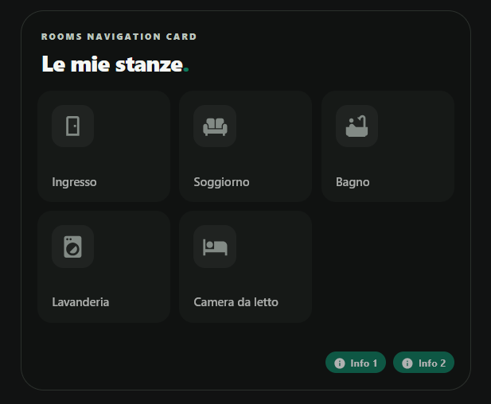

# Rooms Navigation Card

[](https://www.tiktok.com/@luigi.regolo)
[](LICENSE)
[](https://my.home-assistant.io/redirect/hacs_repository/?owner=luigi-regolo&repository=rooms-navigation-card&category=plugin)
[](https://github.com/luigi-regolo/rooms-navigation-card/stargazers)

## Overview

**Rooms Navigation Card** is a custom navigation card for Home Assistant dashboards, featuring a minimalist interface inspired by the Edera Light and Dark visual styles.

It displays existing Home Assistant Areas as room tiles and lets you connect them to existing dashboard views. Optional compact shortcuts provide additional navigation destinations beneath the room grid.

The card does not create, delete, or modify Home Assistant Areas or dashboard views.

## Preview



*Rooms Navigation Card running in a Home Assistant dashboard with Edera Dark styling. The rooms and shortcut labels shown are examples from the configured dashboard.*

## Features

- **Native Home Assistant Areas:** Automatically read room names and icons from the Home Assistant Area registry.
- **Per-card room selection:** Show, hide, restore, and reorder rooms without changing the original Areas.
- **Dashboard navigation:** Link individual rooms to existing Home Assistant dashboard views. Select a discovered view or enter its internal path manually.
- **Optional shortcuts:** Configure, rename, reorder, show, or remove shortcuts such as Information and Climate, with Material Design Icons.
- **Visual editor:** Configure rooms and links under **Stanze**, and titles and visual settings under **Aspetto**.
- **Edera appearance:** Automatic, Light, and Dark appearance, with optional card border and configurable headings.
- **Responsive layout:** Two room columns on smartphones, three on tablets, and up to four on wider desktop layouts, depending on available space.
- **Home Assistant navigation:** Uses internal dashboard paths rather than external website links.

Available dashboard destinations depend on the views accessible in your Home Assistant installation. If a view is not listed in the editor, its existing internal path can be entered manually.

## Installation

### HACS — Custom repository

1. Open **HACS** in Home Assistant.
2. Open the HACS menu and choose **Custom repositories**.
3. Enter `https://github.com/luigi-regolo/rooms-navigation-card`.
4. Select **Dashboard** as the repository type and add it.
5. Download **Rooms Navigation Card** from HACS.
6. Reload the Home Assistant dashboard if needed, then add **Rooms Navigation Card** using the card picker.

[](https://my.home-assistant.io/redirect/hacs_repository/?owner=luigi-regolo&repository=rooms-navigation-card&category=plugin)

HACS installs the JavaScript module from `dist/rooms-navigation-card.js`.

### Manual installation

1. Download `dist/rooms-navigation-card.js` from this repository.
2. Place it in your Home Assistant configuration's `www` directory.
3. In Home Assistant, open **Settings → Dashboards → Resources**.
4. Add `/local/rooms-navigation-card.js` with resource type **JavaScript module**.
5. Reload the dashboard and add **Rooms Navigation Card**.

If the `www` directory has just been created, Home Assistant may need to be restarted before its files become available.

## Configuration and Usage

### Visual editor

After adding the card, open its visual configuration editor:

- **Stanze → Aree:** Choose which native Areas appear, change their order, and assign an existing dashboard view to each room.
- **Stanze → Collegamenti:** Configure the optional shortcuts below the rooms. Shortcuts can be renamed, reordered, hidden, removed, or added.
- **Aspetto:** Customize the small heading, main title, optional outer border, and Automatic / Light / Dark theme.

Room names and their icons come from Home Assistant. Dashboard views must already exist; the card does not generate them.

### Example YAML

```yaml
type: custom:rooms-navigation-card
title: Le mie stanze
theme_mode: auto
show_all_areas: true
```

Use the visual editor to select rooms and assign destinations. A room without a configured destination remains visible but does not open a page when pressed.

## Compatibility and Requirements

- Home Assistant with support for custom JavaScript dashboard cards.
- Access to the Home Assistant Area registry for native room discovery.
- Existing Home Assistant dashboard views for navigation.
- HACS is optional when using manual installation.

No specific minimum Home Assistant version has been independently verified for this project.

Rooms Navigation Card does not require a separate cloud account, subscription, or third-party JavaScript library. It does not implement advertising, analytics, or external telemetry.

## Copyright & License

Copyright © 2026 luigi-regolo.

Original project created and maintained by **luigi-regolo**.

Licensed under the **GNU General Public License version 3 only (GPL-3.0-only)**. See [LICENSE](LICENSE) for the complete terms.

The software is provided without warranty to the extent permitted by applicable law.
