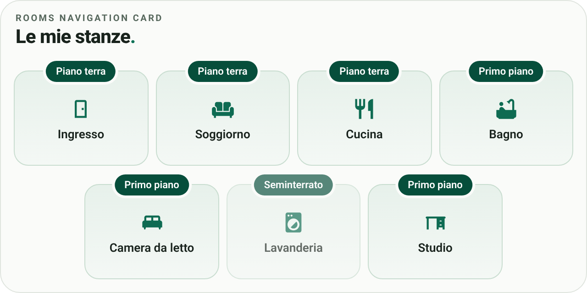
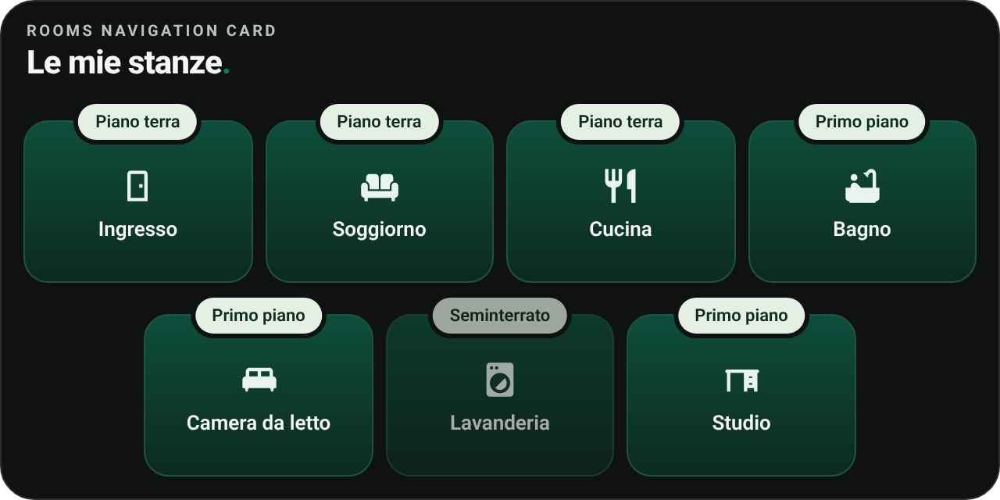
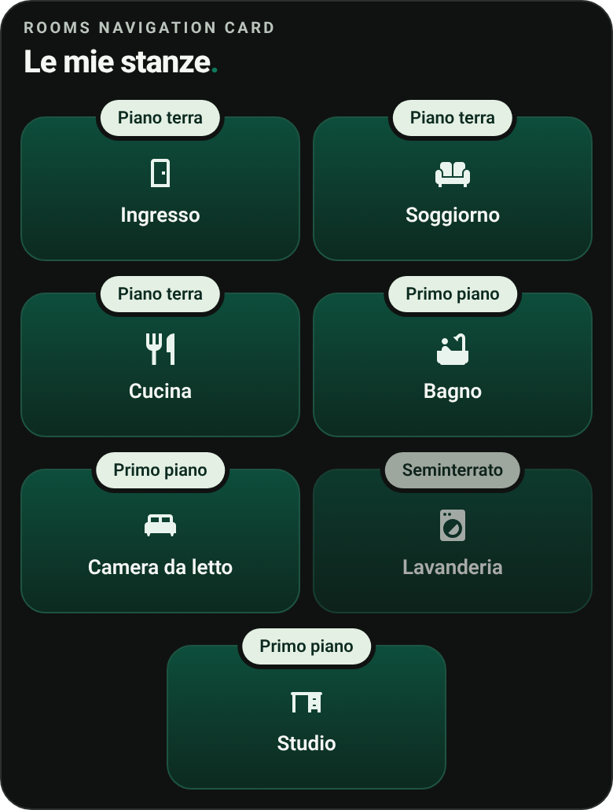

# Rooms Navigation Card

## Overview

**Rooms Navigation Card** is a custom navigation card for Home Assistant dashboards, featuring a minimalist interface inspired by the Edera Light and Dark visual styles.

It displays existing Home Assistant Areas as room tiles, each with an optional pill showing the Area's floor, and lets you connect them to existing dashboard views. Optional compact shortcuts provide additional navigation destinations beneath the room grid.

The card does not create, delete, or modify Home Assistant Areas or dashboard views.

## Preview

| Light | Dark |
| --- | --- |
|  |  |

*Previews use fictional demo data. The card is available in Italian, English, German, and French.*

## Features

- **Native Home Assistant Areas:** Automatically read room names and icons from the Home Assistant Area registry.
- **Per-card room selection:** Show, hide, restore, and reorder rooms without changing the original Areas.
- **Floor pills:** Each room can show its Home Assistant floor in a small pill. The text can be renamed per room or left empty to hide the pill.
- **Dashboard navigation:** Link individual rooms to existing Home Assistant dashboard views. Select a discovered view or enter its internal path manually.
- **Optional shortcuts:** Configure, rename, reorder, show, or remove shortcuts such as Information and Climate, with Material Design Icons. Shortcuts are off by default.
- **Visual editor:** Three sections: **Rooms**, **Links**, and **Appearance**.
- **Four languages:** Italian, English, German, and French. Automatic mode follows the Home Assistant user language, with English as fallback.
- **Edera appearance:** Automatic, Light, and Dark appearance, with optional card border and configurable headings.
- **Responsive layout:** Two room columns on smartphones and four on tablets and desktops. An incomplete last row is centered.
- **Home Assistant navigation:** Uses internal dashboard paths rather than external website links.

Available dashboard destinations depend on the views accessible in your Home Assistant installation. If a view is not listed in the editor, its existing internal path can be entered manually.

## Installation

### Marketplace (Recommended)

Install Rooms Navigation Card directly from the default Marketplace catalog in Home Assistant 2026.11 or newer.

1. Go to **Settings** > **Marketplace**.
2. The first time, accept the notice about community content.
3. Use **Search** to find **Rooms Navigation Card**.
4. Open the repository page and select **Install**.
5. Check the version in the dialog and select **Install** again to confirm.
6. Reload your browser to load the new resource.
7. Add **Rooms Navigation Card** to your dashboard and configure it using the visual editor.

### Manual installation

1. Download `dist/rooms-navigation-card.js` from this repository.
2. Place it in your Home Assistant configuration's `www` directory.
3. In Home Assistant, open **Settings → Dashboards → Resources**.
4. Add `/local/rooms-navigation-card.js` with resource type **JavaScript module**.
5. Reload the dashboard and add **Rooms Navigation Card**.

If the `www` directory has just been created, Home Assistant may need to be restarted before its files become available.

## Configuration and Usage

### Visual editor

After adding the card, open its visual configuration editor:

- **Rooms:** Choose which native Areas appear, change their order, assign an existing dashboard view to each room, and set the pill text.
- **Links:** Configure the optional shortcuts below the rooms. Shortcuts can be turned on, renamed, reordered, removed, or added.
- **Appearance:** Customize the top label, title, pills, optional outer border, Automatic / Light / Dark theme, and language.

Room names and their icons come from Home Assistant. Dashboard views must already exist; the card does not generate them.

Use the visual editor to select rooms and assign destinations. A room without a configured destination remains visible but does not open a page when pressed.

## Compatibility and Requirements

- Home Assistant with support for custom JavaScript dashboard cards.
- Access to the Home Assistant Area registry for native room discovery.
- Floors assigned to Areas in Home Assistant, if you want the floor pills.
- Existing Home Assistant dashboard views for navigation.

No specific minimum Home Assistant version has been independently verified for this project.

Rooms Navigation Card does not require a separate cloud account, subscription, or third-party JavaScript library. It does not implement advertising, analytics, or external telemetry.

## Releases

See [GitHub Releases](https://github.com/luigi-regolo/rooms-navigation-card/releases) for published versions.

## Copyright & License

Copyright © 2026 luigi-regolo.

Original project created and maintained by **luigi-regolo**.

Licensed under the **GNU General Public License version 3 only (GPL-3.0-only)**. See [LICENSE](LICENSE) for the complete terms.

The software is provided without warranty to the extent permitted by applicable law.
